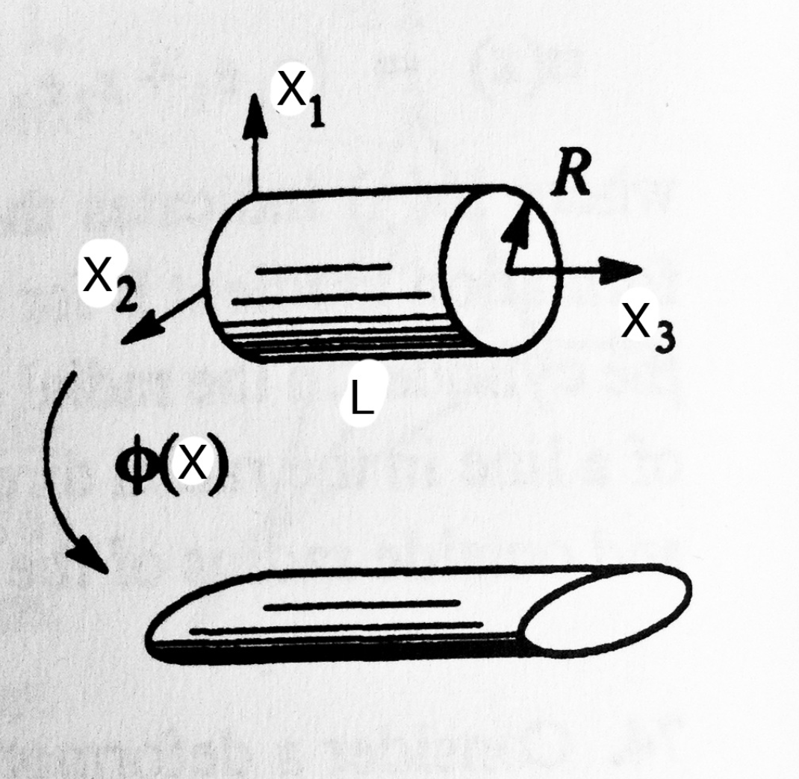
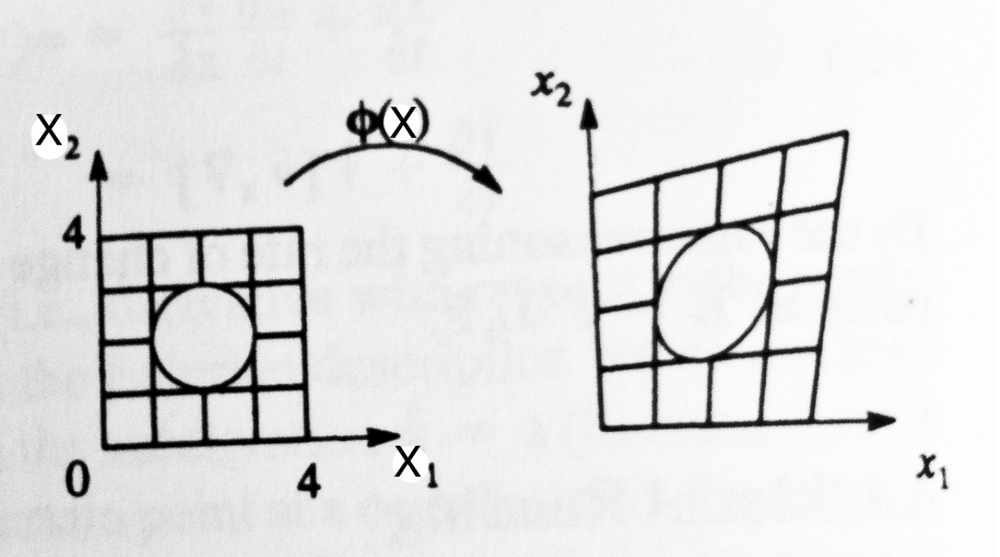

<!-- 
## Notation {-}
 -->

## Problem 1 (35 pts) {-}

A circular cylinder of length L and radius R (Figure 1) undergoes the deformation characterized by
$$
    \bsf{x}[\bsf{X}] = \alpha X_{1} \bsf{E}_{1} + \beta X_{2} \bsf{E}_{2} + \gamma X_{3} \bsf{E}_{3}
$$
where $\alpha, \beta$ and $\gamma$ are constants. Find the total surface area of the deformed cylinder. What are the limits on the constants $\alpha, \beta$ and $\gamma$?

{#fig-cylinder-deform width=50%}

## Problem 2 (35 pts) {-}

Consider a square piece of material of unit thickness with a round hole in it of radius 1 (see Figure 2). The material is subjected to the following deformation map:
$$
    \bsf{x}[\bsf{X}] = X_{1}(1 + \beta X_{2})\bsf{E}_{2} + X_{2}(1 + 3 \beta X_{1})\bsf{E}_{2} + X_{3} \bsf{E}_{3}
$$
Compute the volume of the hole in the undeformed and deformed configurations.

{#fig-square-hole width=70%}

## Problem 3 (30 pts) {-}

Left $\bsf{F}$ be invertible. The right and left polar decompositions of $\bsf{F}$ are given by $\bsf{F} = \bsf{R} \bsf{U}$ and $\bsf{F} = \bsf{V} \bsf{R}$, where $\bsf{R}$ is an orthogonal (rotation) map and $\bsf{U}$ and $\bsf{V}$ are positive semi definite maps, termed the right and left stretch tensors. Further, $\bsf{U} = \sqrt{\bsf{F}^{\msf{T}} \bsf{F}}$ and $\bsf{V} = \sqrt{\bsf{F} \bsf{F}^{\msf{T}}}$.

1. (10 pts) Show that $\bsf{U}$ and $\bsf{V}$ have the same characteristic equation and therefore the same eigenvalues.
1. (10 pts) Do they have the same eigenvectors? Show your work.
1. (10 pts) Explain the physical meaning of your answers to the two previous questions. Compare the physical representation of $\bsf{U}$ and $\bsf{V}$.