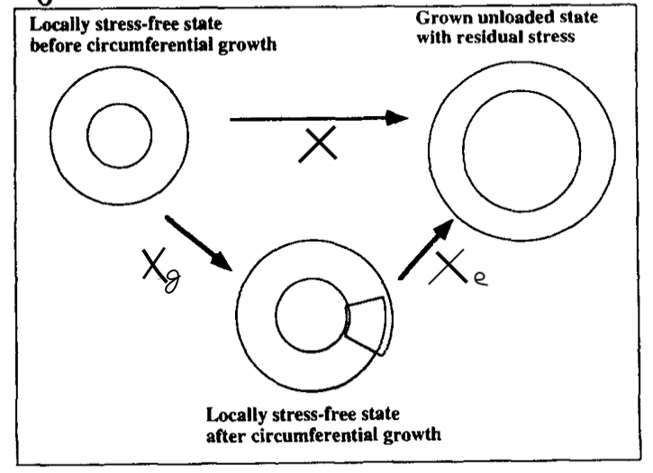
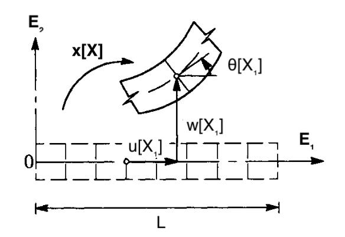

### Rules {-}
1. The midterm should be solved individually. No interaction with any other person is permitted. No external (email, internet, etc.) communication is permitted during the exam.
2. The exam can be taken with open books and notes.
3. Use of calculators, and computers is permitted and encouraged. Computers may **only** be used to refer to class notes, homework problems, and for symbolic math software.
4. Your answers should be succinct and direct. Provide only one solution to each question, even when you can think of several different solution strategies.
5. Your answer sheet should be clean and legible. You will not get credit for answers which are not clearly legible.
6. You should abide by Brown’s Honor Code.
7. In parentheses you will find the number of points each problem represents.
8. Any question about the statement of the exam should be directed to the TA , who will answer to the entire class with a copy of your question.

## Problem 1 (20 pts) {-}

Answer true or false (2 pts each). Provide a brief explanation in one line.

1. The deformation map is always a linear map.
2. An admissible deformation needs to be continuous and injective.
3. The components of a tensor and the tensor are the same thing, i.e., $\bs{C} = C_{ij}$ is a meaningful expression.
4. The components of a vector depend on the basis that is chosen.
5. A homogeneous deformation is an affine map.
6. The right polar decomposition for the deformation gradient always exists but the left polar decomposition may not.
7. The eigenvalues of the right and left stretch tensors are the same.
8. The eigenvectors of the right and left stretch tensors are the same.
9. Strain tensors describe the rotation a piece of material undergoes.
10. Kinematics includes a description of the motion of a body and the forces acting upon it.

## Problem 2 (40 pts) {-}

Consider an initially square block deformed by the following shear deformation
$$
\bsf{x}[\bsf{X}] = \bsf{F} \bsf{X},
$$
where
$$
\bsf{F}=\begin{bmatrix}
1 & \gamma \\
0 & 1
\end{bmatrix}
$$
in the orthonormal basis parallel to the sides of the block and $\gamma=0.2$.

1. (10 pts) Compute the right and left polar decompositions for the deformation gradient $\bsf{F}=\bsf{R} \bsf{U}=\bsf{V} \bsf{R}$.

2. (10 pts) Draw the sequence of deformed blocks obtained by applying $\bsf{U}$ and then $\bsf{R}$, and the sequence obtained by applying $\bsf{R}$ and then $\bsf{V}$. Identify, graphically and analytically, the directions that remain unrotated after applying $\bsf{U}$ and after applying $\bsf{V}$ respectively.

3. (10 pts) Given the matrix representation of a tensor $\bsf{B}$ in an orthonormal basis
$$
\bsf{B}=\begin{pmatrix}
\frac{1}{18} \left(8+5 \sqrt{3}\right) &
  -\frac{8}{9} - \frac{7}{6 \sqrt{3}} & \frac{1}{9} \left(7-5 \sqrt{3}\right)\\
-\frac{4}{9} + \frac{5}{2 \sqrt{3}} & \frac{8}{9} + \frac{1}{2 \sqrt{3}} & -\frac{7}{9} - \sqrt{3}\\
\frac{1}{9} \left(4+5 \sqrt{3}\right) & \frac{1}{9}\left(-8+5 \sqrt{3}\right) & \frac{1}{9} \left(7-4 \sqrt{3}\right)
\end{pmatrix}
$$
If we perform the polar decomposition $\bsf{B}=\bsf{R} \bsf{U}$, with $\bsf{R} \in SO(3)$ and $\bsf{U}$ symmetric, which one of the following is $\bsf{U}$?

a. 
$$
    \begin{pmatrix}
    -\frac{1}{6} & \frac{11}{6} & -\frac{2}{3}\\
    \frac{11}{6} & -\frac{1}{6} & -\frac{2}{3}\\
    -\frac{2}{3} & -\frac{2}{3} & \frac{7}{3}
    \end{pmatrix}
$$

b. 
$$
    \begin{pmatrix}
    \frac{11}{6} & -\frac{1}{6} & -\frac{2}{3}\\
    -\frac{1}{6} & \frac{11}{6} & -\frac{2}{3}\\
    -\frac{2}{3} & -\frac{2}{3} & \frac{7}{3}
    \end{pmatrix}
$$

c. None of the above

4. (10 pts) What is $\bsf{R}$?

## Problem 3a (40 pts) {-}

Consider an elastic body, for example a biological tissue, that is growing, i.e., changing mass. The body may wish to grow in such a way that the growth strain is *incompatible*. For example, the material may wish to penetrate itself or lose connectedness. To maintain compatibility of the deformation, an elastic deformation may develop to restore compatibility of the resultant strain. @fig-cylinder-deform shows the cross section of a cylinder of unit thickness undergoing a growth deformation $\bsf{x}_{g}[\cdot] : B \to B'$ to a configuration that is interpenetrating, and then a subsequent elastic deformation $\bsf{x}_{e}[\cdot] : B' \to B''$ to a compatible configuration. The resultant deformation $\bsf{x}[\cdot] :B \to B''$ is the composition $\bsf{x}[\cdot] = \bsf{x}_{e}[\cdot] \circ \bsf{x}_{g}[\cdot]$.

{#fig-cylinder-deform width=70%}
 
<!-- Here $\bsf{e}_r(\theta) = \cos\theta\,\hat{\bsf{e}}_1 + \sin\theta\,\hat{\bsf{e}}_2$, $\bsf{e}_\theta(\theta) = -\sin\theta\,\hat{\bsf{e}}_1 + \cos\theta\,\hat{\bsf{e}}_2$, $\bsf{e}_z = \hat{\bsf{e}}_3$, and $\bsf{E}_i$ is defined the same way using $\Theta$. That is, $\bsf{E}_i(\Theta)$ and $\bsf{e}_i(\theta)$ are the same cylindrical frame evaluated at the reference and deformed angles; they are different vectors unless $\theta = \Theta$. Note that $(R,\Theta,Z)$ etc. are *coordinates*, not components of a vector in the cylindrical basis. -->

1. (5 pts) Take a Taylor expansion of the map $\bsf{x}[\cdot]$ and show that the first order term (the deformation gradient) is given by
$$
    \bsf{F} = \bsf{F}_{e} \bsf{F}_{g},
$$
where $\bsf{F}_{g}$ is the deformation gradient of the growth deformation with respect to the material coordinates, and $\bsf{F}_{e}$ is the deformation gradient of the elastic deformation with respect to the intermediate *growth* coordinates.

2. (10 pts) All three configurations are described in cylindrical coordinates with the associated local orthonormal bases:  

    - $\bsf{X}  \in B$ has coordinates $(R, \Theta, Z)$ and $\bsf{X} = R\,\bsf{E}_R(\Theta) + Z\,\bsf{E}_Z$.
    - $\bsf{x}_g \in B'$ has coordinates $(r_g, \theta_g, z_g)$ and $\bsf{x}_g = r_g\,\bsf{e}_r(\theta_g) + z_g\,\bsf{e}_z$.
    - $\bsf{x}_e \in B''$ has coordinates $(r, \theta, z)$ and $\bsf{x} = r\,\bsf{e}_r(\theta) + z\,\bsf{e}_z$.  
    
    The deformation maps are given in terms of these coordinates:
    $$
    \begin{aligned}
    \bsf{x}_g &: \quad r_g = R, \quad \theta_g = c\,\Theta, \quad z_g = Z, \\
    \bsf{x}_e &: \quad r = r[r_g], \quad \theta = \varphi[r_g]\,\theta_g, \quad z = \alpha\, z_g,
    \end{aligned}
    $$
    where $c, \alpha > 0$, and $r[\cdot]$ and $\varphi[\cdot]$ are functions of the grown radius. $B = \set{\bsf{X} \in \mbb{R}^{3}}{R_i < R < R_o ~,~ 0 \le \Theta < 2\pi ~,~ 0 < Z < 1}$. 

    Sketch the *grown* annulus $B'$ for $c < 1$ and for $c > 1$. You may use a tool like Mathematica or Python to help you visualize it. What are the differences between the two?

3. (5 pts) Does $\bsf{x}_{g}[\cdot]$ satisfy the standard requirements for an admissible deformation? Does $\bsf{F}_{g}$ have a polar decomposition? What requirements must $\bsf{x}_{e}$ satisfy?

4. (10 pts) The deformation gradient $\bsf{F}$ for a map written in cylindrical coordinates, $(r[R,\Theta,Z],\theta[R,\Theta,Z],z[R,\Theta,Z])$, has the form
$$
\bsf{F} =
\begin{bmatrix}
\dfrac{\partial r}{\partial R} & \dfrac{1}{R}\dfrac{\partial r}{\partial \Theta} & \dfrac{\partial r}{\partial Z} \\[2mm]
r\,\dfrac{\partial \theta}{\partial R} & \dfrac{r}{R}\dfrac{\partial \theta}{\partial \Theta} & r\,\dfrac{\partial \theta}{\partial Z} \\[2mm]
\dfrac{\partial z}{\partial R} & \dfrac{1}{R}\dfrac{\partial z}{\partial \Theta} & \dfrac{\partial z}{\partial Z}
\end{bmatrix}.
$$
Using the formula above, compute $\bsf{F}_{g}$, $\bsf{F}_{e}$ and $\bsf{F}$. (For $\bsf{F}_e$, apply the formula with $(r_g, \theta_g, z_g)$ in place of $(R, \Theta, Z)$.)

5. (10 pts) Which of the following forms for $\varphi[r_g]$ implies that $\bsf{x}[\cdot]$ is admissible and continuous across $\Theta = 0, 2\pi$? Show your work.

    a. $\varphi[r_g] = 1/c$

    b. $\varphi[r_g] = r_g^2/c$

6. (10 pts) Assume that $\bsf{x}_{e}$ is subject to the incompressibility constraint $\det(\bsf{F}_{e}) = 1$. Using this and the admissible form of $\varphi[r_g]$ from the previous question, obtain an expression for the net radial deformation $r = r[R]$. Let the inner surface at a radial coordinate $R = R_{i}$ deform to a radial coordinate of $r = r_i$.

## Problem 3b (40 pts) {-}
Adopted from Hjelmstad, 2005.  
A beam theory is characterized by a specific deformation map that is parameterized by a set of deformation variables that depend only on the axial coordinate $X_{1}$. Let $u[X_{1}]$ represent the displacement of the centroid of the beam in the $X_{1}$ direction, $w[X_{1}]$ the displacement of the centroid of the beam in the $X_{2}$ direction, and $\theta[X_{1}]$ the rotation of a vector normal to the deformed cross section relative to the horizontal. The deformation map for finite planar motion of the beam then takes the form shown in @fig-cylinder-deform. The deformation map has the following form:
$$
  \bsf{x}[\bsf{X}] = (X_{1} + u[X_{1}] - X_{2} \sin \theta[X_{1}]) \bsf{E}_{1} + (w[X_{1}] + X_{2} \cos \theta[X_{1}]) \bsf{E}_{2} + X_{3} \bsf{E}_{3}
$$

{#fig-beam-bending width=70%}

1. (10 pts) Compute the deformation gradient $\bsf{F}$, the Cauchy-Green strain tensor $\bsf{C}$ and the Green-Lagrange strain tensor $\bsf{E} = \frac{1}{2} (\bsf{C} - \bsf{I})$.

2. (10 pts) Assume that the rotation $\theta \ll 1$ and linearize the deformation map (use small angle approximations $\sin \theta \approx \theta$ and $\cos \theta \approx 1$). Compute $\bsf{F}$, $\bsf{C}$ and $\bsf{E}$ for the linearized kinematic description.

3. (10 pts) Is the Green-Lagrange strain linear in the displacement variables $u, w$ and $\theta$ for the linearized kinematic description?

4. (10 pts) Linearize $\bsf{E}$ from part 1 by neglecting squares and products of $u, w$ and $\theta$. What are the consequences of neglecting the higher order terms? 

## References {-}
1. Rodriguez, E. K., Hoger, A., & McCulloch, A. D. (1994). Stress-dependent finite growth in soft elastic tissues. Journal of biomechanics, 27(4), 455-467.
2. Hjelmstad, K. D. (2005). Fundamentals of structural mechanics. Boston, MA: Springer US.